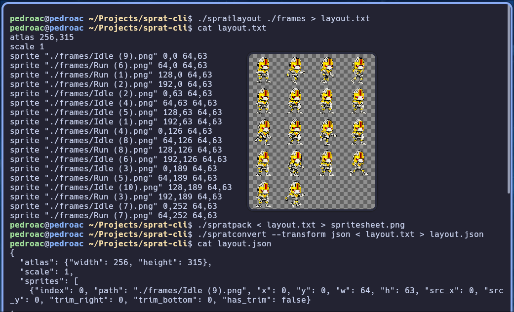

# sprat-cli

**The UNIX-way sprite sheet generator.**



`sprat-cli` is a modular toolkit for generating sprite sheets (texture atlases) from the command line. Unlike monolithic GUI tools, it splits the packing process into discrete, pipeable commands. This makes it perfect for:

*   **CI/CD Pipelines**: Automate asset generation in your build process.
*   **Shell Scripting**: Integrate naturally with `|`, `>`, and standard text tools.
*   **Game Development**: Optimized packing algorithms for GPU memory, plus markers, animations and cutout puppets (rigs, poses and pose sequences) for engines.
*   **Web & Apps**: Export to CSS, JSON, XML, or custom formats.

| Tool | What it does |
|---|---|
| `spratlayout` | Scans images and computes their positions in the atlas (a plain-text layout) |
| `spratpack` | Reads a layout and writes the atlas image |
| `spratconvert` | Turns a layout into metadata: Godot, Unity, Phaser, libGDX, Aseprite, plist, JSON, XML, CSV, CSS or your own Jsonnet transform |
| `spratframes` | Detects the sprites in an existing sheet |
| `spratunpack` | Extracts sprites from an atlas |

## Quick start

Build:

```sh
sh build.sh
```

The binaries are generated in the `build/` directory. Make an atlas and its metadata from a folder of images:

```sh
./build/spratlayout ./frames --trim-transparent --padding 2 > layout.txt
./build/spratpack < layout.txt > spritesheet.png
./build/spratconvert --transform json < layout.txt > layout.json
```

Recover the frames of an existing sheet:

```sh
./build/spratframes sheet.png | ./build/spratunpack --output ./recovered_frames
```

Install binaries, man page, and global profile config:

```sh
sudo cmake --install build
```

Every tool has `--help`, and `man ./man/sprat-cli.1` describes them all.

## Workflow

Each tool does one thing well and communicates via text:

```
./frames ──► spratlayout ──► layout.txt ──┬──► spratpack ────► spritesheet.png
                                          └──► spratconvert ─► layout.json

sheet.png ──► spratframes ──► frames.txt ──► spratunpack ──► ./recovered_frames
```

`spratlayout` computes positions without writing pixels; with the default options it reads
only image headers, and trimming or deduplication loads pixels when needed. Its layouts are
also cached.

## Documentation

**Start with the guides** for practical examples and common workflows:
- **[Guides](docs/guides/)** — How to use each tool
  - [spratlayout](docs/guides/spratlayout.md): packing modes, profiles, workflows
  - [spratpack](docs/guides/spratpack.md): basic options, debugging, variants
  - [spratconvert](docs/guides/spratconvert.md): engine formats, auto-detection
  - [Extracting sprites](docs/guides/extracting.md): spratframes and spratunpack
  - [Markers & Animations](docs/guides/markers-animations.md): pivots, hitboxes, sequences

**Need all the options?** See the [Reference](docs/reference/):
- [spratlayout reference](docs/reference/spratlayout.md): all options, algorithms, caching
- [spratpack reference](docs/reference/spratpack.md): compression, GPU formats, scaling
- [spratconvert reference](docs/reference/spratconvert.md): formats, custom transforms, schema

**Technical details** in [Advanced](docs/advanced/):
- [Layout format](docs/advanced/layout-format.md): nine-slice, dithering, format spec
- [Raw format](docs/advanced/raw-format.md): C/C++ loading
- [Data files](docs/advanced/data-files.md): complete marker/animation/puppet DSL
- [References](docs/references.md): free sprites and optimization reading

## Getting help

- Every tool has `--help`: `./build/spratlayout --help`, `./build/spratpack --help`, etc.
- Full manual: `man ./man/sprat-cli.1` (or `man sprat-cli` after installing)
- Detailed docs: see the links above

## Contributing

Suggestions, pull requests, and forks are welcome. See [CONTRIBUTING.md](CONTRIBUTING.md).

## License

MIT. See [LICENSE](LICENSE).

## Support

[](https://buymeacoffee.com/pedroac)
