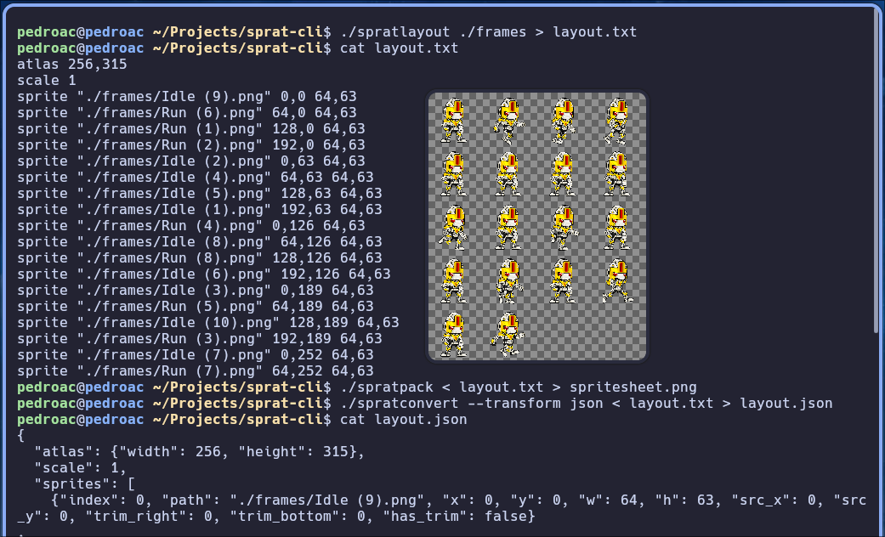
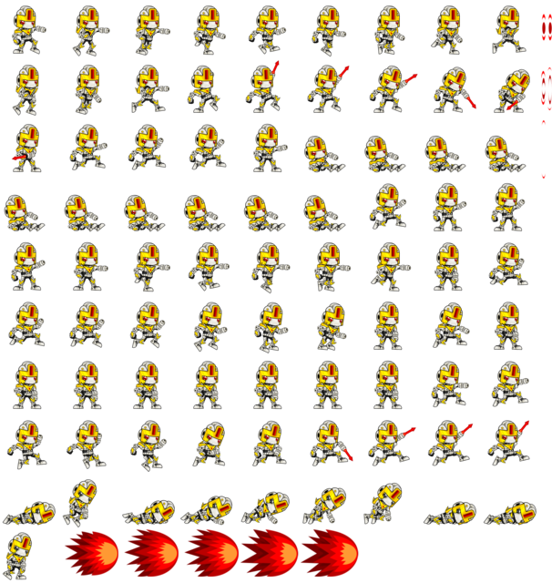
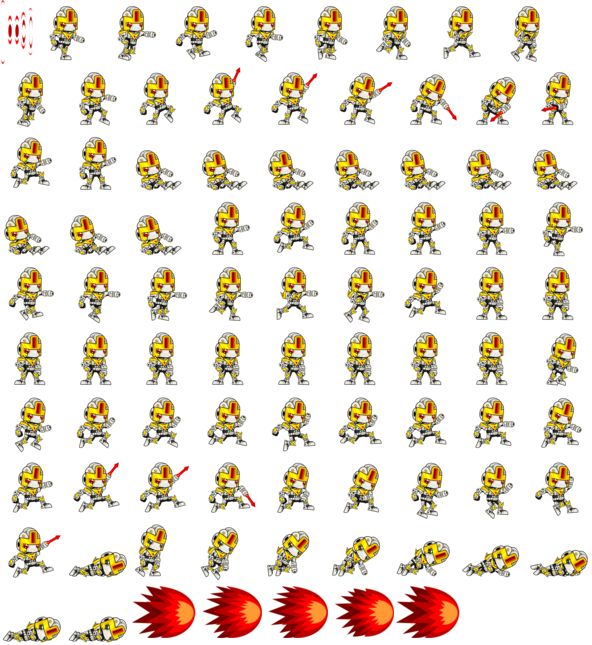
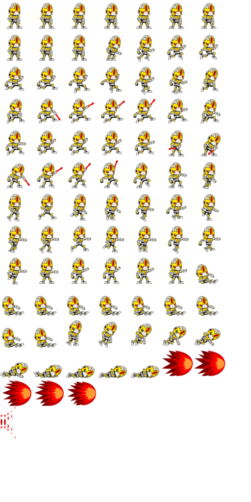
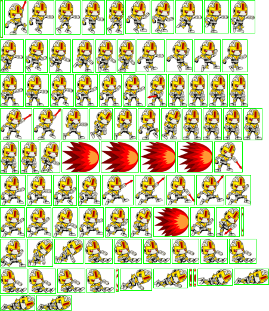
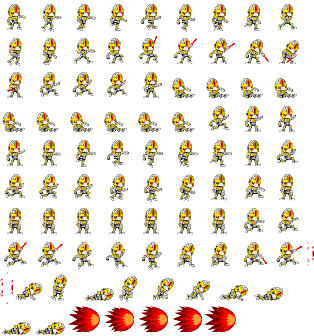
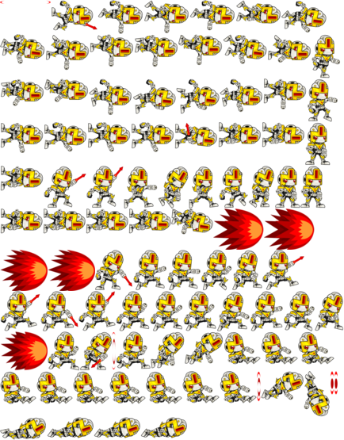

# sprat-cli

**The UNIX-way sprite sheet generator.**



`sprat-cli` is a modular toolkit for generating sprite sheets (texture atlases) from the command line. Unlike monolithic GUI tools, it splits the packing process into discrete, pipeable commands (`spratlayout`, `spratpack`, `spratconvert`, `spratframes`, `spratunpack`). This makes it perfect for:

*   **CI/CD Pipelines**: Automate asset generation in your build process.
*   **Shell Scripting**: Integrate naturally with `|`, `>`, and standard text tools.
*   **Game Development**: Optimized packing algorithms for GPU memory.
*   **Web & Apps**: Export to CSS, JSON, XML, or custom formats.

---

## 🚀 Quick Start

**Build:**

```sh
sh build.sh
```

The binaries are generated in the `build/` directory. You can run them directly from there:

Generate layout first:

```sh
./build/spratlayout ./frames > layout.txt
```

Inspect layout text:

```sh
cat layout.txt
```

Pack PNG from that layout:

```sh
./build/spratpack < layout.txt > spritesheet.png
```

Optional one-pipe run:

```sh
./build/spratlayout ./frames --trim-transparent --padding 2 | ./build/spratpack > spritesheet.png
```

**New: Tar File Support**

`spratlayout` now accepts tar archives as input. This is useful for bundling sprite assets or working with compressed archives.

```sh
# Regular tar file
./build/spratlayout sprites.tar > layout.txt

# Compressed tar files (gzip, bzip2, xz)
./build/spratlayout sprites.tar.gz > layout.txt
./build/spratlayout sprites.tar.bz2 > layout.txt
./build/spratlayout sprites.tar.xz > layout.txt
```

The tool automatically extracts the archive to a temporary directory and processes all image files found within. Temporary directories are cleaned up automatically after processing.

Convert layout to JSON/CSV/XML/CSS:

```sh
./build/spratconvert --transform json < layout.txt > layout.json
```

Detect sprite frames in spritesheets:

```sh
./build/spratframes spritesheet.png > frames.spratframes
```

Extract sprites from spritesheets using frame coordinates:

```sh
./build/spratunpack spritesheet.png --frames frames.spratframes --output output/
```

Manual page:

```sh
man ./man/sprat-cli.1
```

Per-command help:

```sh
./build/spratlayout --help
./build/spratpack --help
./build/spratconvert --help
./build/spratframes --help
./build/spratunpack --help
```

## Installation

Install binaries, man page, and global profile config:

```sh
sudo cmake --install build
```

## Workflow

`sprat-cli` follows the UNIX philosophy: each tool does one thing well and communicates via text. The standard pipeline consists of three steps:

                    ┌───────────────────────────┐
                    │       IMAGE FOLDER        │
                    │        ./frames           │
                    └─────────────┬─────────────┘
                                  │
                                  ▼
                        ┌─────────────────┐
                        │   spratlayout   │
                        │   (scanning)    │
                        │  math only      │
                        └────────┬────────┘
                                 │  stdout
                                 ▼
                           layout.txt
                                 │
              ┌──────────────────┴──────────────────┐
              ▼                                     ▼
     ┌─────────────────┐                   ┌─────────────────┐
     │    spratpack    │                   │  spratconvert   │
     │    (packing)    │                   │ (transforming)  │
     │  layout → PNG   │                   │ layout → JSON   │
     └────────┬────────┘                   └────────┬────────┘
              │ stdout                              │ stdout
              ▼                                     ▼
     spritesheet.png                          layout.json

### 1. Scanning (`spratlayout`)
Scans a folder of images and calculates their optimal positions. It prints a **layout text** to stdout. This step is mathematical and does not process image pixels, making it extremely fast.
```sh
./build/spratlayout ./frames > layout.txt
```

### 2. Packing (`spratpack`)
Reads the layout text from stdin, loads the images, and blits them into a single PNG atlas.
```sh
./build/spratpack < layout.txt > spritesheet.png
```

### 3. Transforming (`spratconvert`)
Reads the layout text and transforms it into a metadata format (JSON, CSV, XML, etc.) for your game engine.
```sh
./build/spratconvert --transform json < layout.txt > layout.json
```

### Extra: Deconstruction (Reverse Engineering)
             ┌──────────────────────────┐
             │   existing_sheet.png     │
             └─────────────┬────────────┘
                           │
                           ▼
                    ┌──────────────┐
                    │ spratframes  │
                    │  (detect)    │
                    └───────┬──────┘
                            │ stdout
                            ▼
                        frames.txt
                            │
                            ▼
                    ┌──────────────┐
                    │ spratunpack  │
                    │  (unpack)    │
                    └───────┬──────┘
                            ▼
                    ./recovered_frames
                            │
                            ▼
                       (feeds into)
                       spratlayout
If you start with a monolithic spritesheet and need to recover individual frames:

**The One-liner (Recommended):**
```sh
./build/spratframes sheet.png | ./build/spratunpack --output ./recovered_frames
```

**Step-by-step (if you need to edit the layout first):**
1.  **Detect (`spratframes`)**: Scans an existing spritesheet and prints a layout definition to stdout.
    ```sh
    ./build/spratframes existing_sheet.png > frames.txt
    ```
2.  **Unpack (`spratunpack`)**: Takes the sheet and the detected frames to extract individual images.
    ```sh
    ./build/spratunpack existing_sheet.png --frames frames.txt --output ./recovered_frames
    ```
Now you can use `./recovered_frames` as the input for `spratlayout`.

---

## Configuration & Profiles

### Profiles
Profiles are named rule sets that group packing options (mode, padding, scale, etc.). Instead of passing ten flags to `spratlayout`, you can define a profile in `spratprofiles.cfg` and use it with `--profile NAME`.

Profile definitions are searched in:
1. `--profiles-config PATH` (CLI override)
2. `{exe_dir}/spratprofiles.cfg` (beside the executable, portable install)
3. User config:
   - Linux: `$XDG_CONFIG_HOME/sprat/spratprofiles.cfg` (default `~/.config/sprat/`)
   - macOS: `~/Library/Application Support/sprat/spratprofiles.cfg`
   - Windows: `%APPDATA%\sprat\spratprofiles.cfg`
4. `/usr/local/share/sprat/spratprofiles.cfg` (Global)

### Spratlayout Options
- `--mode compact|pot|fast`: Packing algorithm choice.
- `--optimize gpu|space`: Prioritize GPU-friendly dimensions or minimum area.
- `--max-width N`: Maximum atlas width.
- `--max-height N`: Maximum atlas height.
- `--no-max-width`: Disable max width limit even if profile sets one.
- `--no-max-height`: Disable max height limit even if profile sets one.
- `--padding N`: Pixels between sprites to prevent texture bleeding.
- `--extrude N`: Repeat edge pixels N times (requires padding >= extrude * 2).
- `--trim-transparent`: Remove empty borders to save space.
- `--rotate`: Allow 90-degree rotation during packing for tighter layouts.
- `--rotate-direction cw|ccw`: Direction rotated sprites are turned in the atlas (default `cw`). Use `ccw` for libGDX. Also available as profile key `rotate_direction=ccw`.
- `--multipack`: Enable multi-atlas candidate search and splitting.
- `--deduplicate none|exact|perceptual`: Detect duplicate sprites and create aliases (saves atlas space).
- `--dedup-threshold N`: Max perceptual-hash distance (0-64, default `5`) for a pair to be compared in `perceptual` mode.
- `--dedup-tolerance N`: Max per-channel pixel difference (0-255, default `8`) for `perceptual` mode to merge two sprites.
- `--incremental`: Reuse positions of unchanged sprites from the previous run, packing only new/changed ones (single atlas only; falls back to a full repack if they don't fit). `pot` atlases keep power-of-two sides; `grid` mode ignores this option. Also available as profile key `incremental=true`.
- `--sort name|none|stable[:metric]`: Order of sprites in layout (default: `none`). Images of a folder or archive are always read in natural filename order (`walk2` before `walk10`), so a folder gives the same layout on every filesystem; list files and `--stdin-list` keep their own order.
- `--scale F`: Pre-scale images (0.0 to 1.0). A trimmed sprite's packed size is chosen so that its original size scales to exactly `round(width × F)` × `round(height × F)`, so animation frames of one size keep one size at any scale.
- `--threads N`: Parallelize the packing search.
- `--debug`: Enable detailed error reporting and debug visualization.
- Directory inputs honor `.spratlayoutignore`; list files may include `exclude "path"` entries.

### Layout Caching
`spratlayout` automatically caches image metadata and layouts in a private per-user directory inside the system temp directory (`$TMPDIR/sprat-<uid>` on Linux/macOS, `%TEMP%\sprat` on Windows). If your source images and options haven't changed, subsequent runs will be nearly instantaneous. Every option that affects the result is part of the cache key, so changing one always recomputes the layout. Entries older than one hour are pruned automatically, and a new `sprat-cli` version never reuses entries written by another version. On Linux/macOS the cache is skipped if that directory is not owned by you or is writable by others. Archive inputs (tar, zip, 7z, rar, or a tar on stdin) are extracted to a new temporary folder on every run, removed afterwards, and are not cached; `--debug` output is not cached either.

### Duplicate Detection
Detect and alias duplicate sprites to save atlas space. `spratlayout` packs only one canonical copy per unique content and emits aliases for the rest:

- `--deduplicate exact`: content hash; only pixel-identical sprites are merged.
- `--deduplicate perceptual`: near-identical sprites are merged, such as re-exports with slight compression noise or dithering. A perceptual hash (dHash) picks candidate pairs (`--dedup-threshold N`, default `5`). The candidates are then compared pixel by pixel and merged only if every RGBA channel is within `--dedup-tolerance N` (default `8`). Pixels that are fully transparent in both sprites are ignored. Each duplicate is compared against its group's canonical sprite, so differences can't add up along a chain of similar sprites. Palette swaps and animation frames with small changes (such as a blink) stay separate.

Both modes compare the trimmed pixels, so a frame that only moves within its canvas (such as a bobbing idle frame) still counts as a duplicate. Sprites with different nine-slice insets are never merged.

```sh
# Generate layout with duplicate detection
./build/spratlayout ./frames --deduplicate exact > layout.txt
```

The layout file will contain `alias` lines for duplicates:
```
sprite "original.png" 0,0 32,32 4,10 4,6
alias "duplicate.png" "original.png"
alias "moved.png" "original.png" 4,4 4,12
```

An alias whose trim offsets differ from its canonical sprite's carries its own `left,top right,bottom` trim, so engines put it back at its original place in the canvas.

When converting to JSON/metadata, every alias becomes its own frame that points to the canonical atlas region:
```sh
./build/spratlayout ./frames --deduplicate exact | ./build/spratconvert --transform json > layout.json
```

In the built-in `json` transform, alias entries have an `alias_of` field with the canonical sprite path. Every format, such as Phaser, Godot or Unity, lists alias frames under their own names. This feature is especially useful for large asset collections with repeated sprites, reducing both atlas size and build time.

---

## Multipacking

Use `--multipack` to allow splitting across multiple atlases. With explicit max limits, splitting is constrained by those limits. With limits disabled, `--optimize` still influences whether one or more atlases are selected.

```sh
# Force small atlases to trigger multipack
./build/spratlayout ./frames --max-width 512 --max-height 512 --multipack > layout.txt
```

The layout file will contain multiple `atlas` lines. `spratpack` can then generate multiple PNG files:

```sh
# Output atlas_0.png, atlas_1.png, etc.
./build/spratpack -a atlas_%d.png < layout.txt
```

You can also extract a specific atlas index:
```sh
./build/spratpack --atlas-index 1 < layout.txt > second_atlas.png
```

Each `spratconvert` format handles several atlases the way its engine expects:

| Format | Multipack output |
|---|---|
| `json`, `xml`, `csv`, `css`, `libgdx` | One file covering every atlas |
| `phaser-hash`, `phaser-array` | One Phaser multi-atlas JSON (`textures: [...]`), loaded with `this.load.multiatlas` |
| `godot` | One file with an `atlases` list; each frame has an `atlas` index |
| `plist`, `aseprite`, `unity.json` | One file per atlas, named after it (`atlas_0.plist`, ...); requires `--output-dir` |
| `unity.meta` | One `<atlas>.meta` per atlas PNG (`atlas_0.png.meta`, ...), each with its own GUID; requires `--output-dir` (a single atlas is also written as `<atlas>.meta` when `-a` names it) |
| `unity.anim` | Each frame references the GUID of the atlas its sprite was packed into |

```sh
./build/spratconvert --transform plist -a atlas_%d.png --output-dir ./out < layout.txt
# out/atlas_0.plist, out/atlas_1.plist, ...
```

Single-atlas layouts are unaffected.

---

## Packing Examples

### Compact Mode (GPU Optimized)

Tries to keep the atlas square-ish but prioritizes width/height that fits well in GPU memory.

!Compact GPU

```sh
./build/spratlayout ./frames --mode compact --optimize gpu --padding 2 > layout.txt
./build/spratpack < layout.txt > compact_gpu_pad2.png
```


### Compact Mode (Space Optimized)

Tries to minimize total area, regardless of aspect ratio.

```sh
./build/spratlayout ./frames --mode compact --optimize space --padding 2 > layout.txt
./build/spratpack < layout.txt > compact_space.png
```


### Fast Mode

Default behavior (used by the default `fast` profile).

Uses a shelf packing algorithm. Much faster for huge datasets, but less efficient packing.

```sh
./build/spratlayout ./frames --mode fast --padding 2 > layout.txt
./build/spratpack < layout.txt > fast.png
```


### Power of Two (POT)

Forces the output atlas to be a power of two (e.g., 512x512, 1024x512), with or without padding. `--max-width`/`--max-height` then allow the largest power of two within them (a limit of 1000 allows 512), and sprites larger than that are refused with an error.

```sh
./build/spratlayout ./frames --mode pot --padding 2 > layout.txt
./build/spratpack < layout.txt > pot.png
```


### Trimming Transparency

Removes transparent pixels from sprite edges. `spratpack` can draw frame lines to visualize the trimmed bounds or apply `--extrude` to avoid sampling artifacts on edges.

```sh
./build/spratlayout ./frames --trim-transparent --padding 2 --extrude 1 > layout.txt
./build/spratpack < layout.txt > spritesheet.png
```


### Resolution Mapping

Automatically scales sprites based on a target resolution. Useful for multi-platform builds (e.g., designing for 4K, building for 1080p).

```sh
# Scale = 1920 / 3840 = 0.5
./build/spratlayout ./frames \
  --source-resolution 3840x2160 \
  --target-resolution 1920x1080 \
  --padding 2 > layout.txt
./build/spratpack < layout.txt > resolution.png
```


### Rotation

Allows 90-degree rotation of sprites to achieve even tighter packing. Sprites are turned clockwise by default, which is what TexturePacker-style formats expect (`phaser-hash`, `phaser-array`, `aseprite`, `plist`, `godot`, `unity.json`). libGDX expects counter-clockwise, so pass `--rotate-direction ccw`; the layout then carries a `rotation ccw` line that `spratpack`, `spratunpack` and `spratconvert` honor.

```sh
./build/spratlayout ./frames --rotate --trim-transparent > layout.txt
./build/spratpack < layout.txt > rotation.png

# libGDX
./build/spratlayout ./frames --rotate --rotate-direction ccw > layout.txt
./build/spratpack < layout.txt > atlas.png
./build/spratconvert --transform libgdx -a atlas.png < layout.txt > atlas.atlas
```

Formats with a fixed convention fail with an explanatory error instead of writing wrong metadata when the layout's direction doesn't match. `unity.meta` (and so the `unity` group) refuses rotated sprites in either direction. A group writes no files when any of its members fails. `json`, `xml` and `csv` report the rotation in clockwise degrees (`90` or `270`), and `css` handles both directions.


## Complete Optimization Workflow

Here's an example combining multiple features for maximum optimization:

```sh
# 1. Generate layout with deduplication and trimming
./build/spratlayout ./frames \
  --deduplicate exact \
  --trim-transparent \
  --padding 2 \
  --extrude 1 \
  --multipack \
  > layout.txt

# 2. Pack with artifact reduction (dilation) and zopfli compression
./build/spratpack \
  --dilate 1 \
  --zopfli \
  --frame-lines \
  < layout.txt > spritesheet.png

# 3. Generate metadata for game engine
./build/spratconvert \
  --transform json \
  --auto-animations \
  < layout.txt > layout.json
```

This pipeline:
- Removes duplicate sprites (saves atlas space)
- Trims transparent borders (reduces pixel bloat)
- Adds safe padding/extrusion (prevents sampling artifacts)
- Enables dilation (bleeds colors to prevent halos)
- Compresses with Zopfli (smallest possible file)
- Generates game-ready metadata with animations

For GPU-native compression (when libsquish is available):
```sh
./build/spratlayout ./frames --deduplicate exact --trim-transparent --padding 2 | \
./build/spratpack --dilate 1 --gpu-compress dxt5 > atlas.dds
```

---

## Advanced Packing (`spratpack`)

### Zopfli Compression
Produce smaller PNGs using the Zopfli algorithm. It is significantly slower but provides better compression than standard deflate. Only valid for PNG output; `spratpack` exits with an error if it was built without zopflipng support.
```sh
./build/spratpack --zopfli < layout.txt > optimized.png
```

### Protection & Obfuscation
Protect your assets with basic XOR-based obfuscation.
```sh
./build/spratpack --protect < layout.txt > protected.png
```
`spratunpack` and other tools in the suite automatically handle de-obfuscation when they detect the "SPRAT!" signature.

### Artifact Reduction (Dilation)
Prevent dark halos around sprites in GPU bilinear filtering by bleeding opaque pixel colors into adjacent transparent pixels.
```sh
# Single pass dilation
./build/spratpack --dilate 1 < layout.txt > dilated.png

# Multiple passes for stronger effect
./build/spratpack --dilate 2 < layout.txt > dilated.png
```
The `--dilate N` flag performs N passes of color dilation around each sprite, filling transparent pixels up to N pixels away from visible ones with their RGB values while keeping alpha at 0. This is essential when using `--extrude` or padding, as GPU sampling can pull transparent pixels at edges. Dilation and extrusion never write inside another sprite's rectangle: with less padding than `2 × extrude` between two sprites, `spratpack --extrude` is cut short between them instead of overwriting them.

### Hardware Texture Compression
Compress atlases to GPU-native DXT formats (requires libsquish library).
```sh
# Compress to DXT1 (RGB, best compression)
./build/spratpack --gpu-compress dxt1 < layout.txt > atlas.dds

# Compress to DXT5 (RGBA with alpha channel)
./build/spratpack --gpu-compress dxt5 < layout.txt > atlas.dds
```
DXT/BC compression provides 4:1 or 6:1 compression ratios and loads directly into GPU memory without decompression. Atlases are padded with transparent pixels to a multiple of 4 (Direct3D 10+ require it); sprite coordinates are unchanged, since the padding is at the right and bottom. Fully transparent pixels take the colour of the visible pixels in their 4x4 block before compression, so they don't darken sprite edges.

`--gpu-quality fast` (default) uses libsquish's range fit; `--gpu-quality best` uses cluster fit, about 1–2 dB better and roughly 25x slower (a 2048x2048 atlas: about 0.5 s versus 12 s on 12 threads). Compression runs on `--threads` threads and gives the same file with any count. Atlases larger than about 23170x23170 are refused (libsquish's size limit; Direct3D itself supports up to 16384x16384).

libsquish is used when installed (`apt install libsquish-dev`, `brew install squish`, vcpkg `squish`); otherwise CMake downloads and builds the pinned 1.15 release into `_deps`. Pass `-DSPRAT_DOWNLOAD_SQUISH=OFF` to build without it, in which case `--gpu-compress` reports that it is not compiled in.

### Output Scale
Scale the whole output atlas (dimensions and sprite positions) by a factor. `--scale-filter` selects the resampling filter.
```sh
./build/spratpack --output-scale 0.5 < layout.txt > atlas_half.png
```

### Secondary Atlases (Normal & Collision Maps)
Pack companion maps with the same layout so every sprite lines up with the color atlas. `--path-suffix` loads `hero_n.png` instead of `hero.png`, and so on.
```sh
./build/spratlayout ./frames > layout.txt
./build/spratpack -a atlas_%d.png < layout.txt
./build/spratpack --path-suffix _n -a normal_%d.png < layout.txt
# Collision maps can be packed at a lower resolution
./build/spratpack --path-suffix _col --output-scale 0.25 -a collision_%d.png < layout.txt

./build/spratconvert --transform godot -a atlas_%d.png \
  --normal-atlas normal_%d.png \
  --collision-atlas collision_%d.png --collision-scale 0.25 \
  < layout.txt > atlas.tres
```
`--collision-scale` must match the `--output-scale` used to pack the collision atlas, so engines can map sprite coordinates onto it. Transforms receive `has_normal_atlas`, `has_collision_atlas`, `collision_atlas_path` and `collision_atlas_scale`. `godot` emits `normal_image`, `collision_image` and `collision_scale`, `unity.json` adds `_NormalMap`/`_CollisionMap` secondary textures, and `json` includes the paths per atlas.

### Nine-Slice (Slice) Metadata
Annotate sprites with nine-slice insets and per-axis fill modes for UI scaling. Add a `slice=` token to any sprite line in the layout:

```
slice=L,T,R,B[,H_MODE,V_MODE]
```

- `L,T,R,B` — non-negative integer insets (left, top, right, bottom) defining the nine-slice grid.
- `H_MODE,V_MODE` — optional fill modes for the horizontal and vertical stretchable regions:
  - `stretch` (default) — scales the region to fill the available space.
  - `repeat` — tiles the region at its original size without scaling.
  - `mirror` — tiles with alternating flips.
  - `fixed` — the region is not resized; source pixels are used as-is.

Examples:
```
sprite "panel.png" 0,0 64,64 slice=8,8,8,8
sprite "border.png" 0,0 64,64 slice=8,8,8,8,repeat,stretch
sprite "frame.png" 0,0 64,64 slice=10,12,10,12,mirror,mirror
sprite "button.png" 0,0 32,32 slice=4,4,4,4,fixed,fixed
```

When `slice=` is present, `spratconvert` emits `slice_left`, `slice_top`, `slice_right`, `slice_bottom`, `slice_h`, and `slice_v` fields per sprite in the transform data.

#### Android nine-patch auto-detection
`spratlayout` automatically detects nine-slice insets from Android [nine-patch](https://developer.android.com/studio/write/draw9patch) images (files ending in `.9.png`). The 1px marker border is stripped and the stretch region is read from the opaque black pixels on the top row and left column. No manual `slice=` annotation is needed — the layout file will contain the correct `slice=` token after generation.

Auto-detected insets always use `stretch` for both fill modes. To use `repeat`, `mirror`, or `fixed`, manually edit the emitted `slice=` token in `layout.txt`.

### Per-sprite Dithering & Quantization
Advanced users can manually edit `layout.txt` to apply per-sprite effects.
- `dither`: Enables ordered dithering for the sprite.
- `colors=N`: Posterizes the sprite to N levels per RGB channel (2-256), i.e. at most N³ colors; alpha is kept.

Example layout line:
`sprite "./frames/robot.png" 0,0 128,128 dither colors=16`

---

## Layout transforms (`spratconvert`)

`spratconvert` reads layout text from stdin and writes transformed output to stdout.
Transforms are [Jsonnet](https://jsonnet.org/) files that receive the full layout data and produce any text format for your game engine or pipeline.

List built-in transforms:

```sh
./build/spratconvert --list-transforms
```

Use a built-in transform:

```sh
./build/spratconvert --transform json < layout.txt > layout.json
```

Provide `--atlas` so atlas paths are deterministic in multi-atlas layouts:

```sh
./build/spratconvert --transform json --atlas atlas_%d.png < layout.txt > layout.json
```

#### Image paths inside the metadata

By default, the metadata refers to each atlas image exactly as `--atlas` names it. Engines (Cocos2d-x, libGDX, Phaser, Unity, ...) usually resolve that reference relative to the metadata file, so a directory in `--atlas` ends up repeated: with `--atlas out/atlas_%d.png --output-dir out`, the files land in `out/`, but they point to `out/atlas_0.png`, i.e. `out/out/atlas_0.png` from the metadata's point of view.

Use `--image-path PATTERN` (same `%d` syntax) to choose the reference written into the metadata. `--atlas` still names the per-atlas output files and seeds stable IDs such as Unity GUIDs; without `--atlas`, `--image-path` names them too.

```sh
./build/spratconvert --transform plist --atlas out/atlas_%d.png --image-path atlas_%d.png \
  --output-dir out < layout.txt
# out/atlas_0.plist refers to "atlas_0.png"
```

`--normal-atlas` and `--collision-atlas` are written as given.

### Automatic Animations
Automatically group sprites into animations based on their filenames (e.g., `hero_walk_01.png`, `hero_walk_02.png` -> animation `hero_walk`).
```sh
./build/spratconvert --transform json --auto-animations < layout.txt > layout.json
```

### Pivot Points
Define pivot points (anchors) for sprites using markers.
1.  **Per-sprite pivot**: Add a marker named `pivot` of type `point` to a specific sprite.
2.  **Global pivot**: Add a marker named `pivot` of type `point` without a `path`.

`spratconvert` resolves pivot positions and exposes them as `has_pivot`, `pivot_x`, `pivot_y`, `pivot_x_norm`, `pivot_y_norm`, `pivot_y_norm_raw`, `pivot_rect_x_norm` and `pivot_rect_y_norm` on each sprite object.

Marker coordinates (pivots, hitboxes, ...) are in the original image's pixels, so they don't change when you pack at another `--scale`. Exported metadata is in atlas pixels: `spratconvert` scales markers, trims and nine-slice insets by the layout's `scale`, the way the packed sprite size already is. For nine-patch (`.9.png`) images, the original image is the content inside the 1px marker border.

Sprites without a pivot marker get no pivot in formats where a pivot overrides the engine default (`phaser-*`, `unity.json`), and `unity.meta` uses the center of the original image.

Example `markers.txt`:
```txt
# Global default pivot
- marker "pivot" point 16,16

path "./frames/hero.png"
# Specific pivot for hero
- marker "pivot" point 32,64
```

Optional extra data files:

```sh
./build/spratconvert --transform json --markers markers.txt --animations animations.txt < layout.txt > layout.json
```

### Transform search paths

Transform files are searched in:
1. `{exe_dir}/transforms/` (beside the executable, portable install)
2. User data dir:
   - Linux: `$XDG_DATA_HOME/sprat/transforms/` (default `~/.local/share/sprat/transforms/`)
   - macOS: `~/Library/Application Support/sprat/transforms/`
   - Windows: `%APPDATA%\sprat\transforms\`
3. `/usr/local/share/sprat/transforms/` (Global)

### Built-in transforms

| Name | Output | Notes |
|------|--------|-------|
| `json` | JSON | Generic metadata: sprites, atlases, animations, markers |
| `csv` | CSV | Flat spreadsheet-friendly list |
| `xml` | XML | Generic XML |
| `css` | CSS | CSS sprite sheet |
| `aseprite` | JSON | Aseprite JSON Array format; frameTags built from animations (non-contiguous animations become multiple tags); one file per atlas for multipack |
| `libgdx` | Text | LibGDX Atlas format; handles multipack; rotated sprites require `--rotate-direction ccw` |
| `godot` | JSON | Godot SpriteFrames resource; each animation lists its `frames` in play order (`from`/`to` only when they form one ascending run); multipack adds `atlases` and a per-frame `atlas` index |
| `phaser-hash` | JSON | Phaser 3 hash-keyed sprite sheet; multi-atlas JSON for multipack |
| `phaser-array` | JSON | Phaser 3 array-keyed sprite sheet; multi-atlas JSON for multipack |
| `phaser-anims` | JSON | Phaser 3 animation config; frames use `texture_key` (e.g. `atlas` for a multipack `atlas_%d.png`) |
| `plist` | plist | Apple / TexturePacker plist; one file per atlas for multipack |
| `unity` | Group | `unity.json` + `unity.meta` + one `unity.anim` per animation (file named after it, with path characters and a leading dot replaced by `_`, and a `_` prefix for Windows device names such as `con`); the clips reference the texture GUID of the `.meta`, which comes from the `-a` name, so pass `-a atlas.png` (also naming the file `atlas.png.meta`) to keep the textures of one project apart; requires `--output-dir`; multipack writes one `.json` and one `<atlas>.meta` per atlas; rotated sprites are not supported (Unity sprite rects have no rotation); in `unity.meta` the pivot and nine-slice border are relative to the trimmed sprite rect |

### Transform format

Each transform is a Jsonnet file that evaluates to a JSON object:

- `name` — display name
- `description` — shown by `--list-transforms`
- `extension` — output file extension (e.g. `".json"`)
- `content` — string output for a single file
- `filename` — optional, with `content`: the file name used with `--output-dir` instead of `{variant}{extension}` (stdout output ignores it); `unity.meta` uses it to write `<atlas>.meta` when `-a` names the atlas
- `files` — array of `{filename, content}` for multi-file output; mutually exclusive with `content`, requires `--output-dir`. Each `filename` must be a unique plain file name that is valid on every platform: no `/`, `\`, `:`, `*`, `?`, `"`, `<`, `>`, `|` or `..`, no trailing dot or space, and no Windows device name such as `CON`, `NUL`, `COM1` or `LPT1` (with or without an extension); otherwise nothing is written. `lib.safe_filename(name)` in `sprat.libsonnet` turns arbitrary names into valid ones

The layout data is available as `std.extVar("sprat")`:

```jsonnet
local sprat = std.extVar("sprat");
```

**Global fields:**

| Field | Type | Description |
|---|---|---|
| `sprites` | array | All sprites across all atlases |
| `atlases` | array | Each entry has `index`, `width`, `height`, `path`, `stem`, `filename`, `hash_hex` (FNV-1a of `path`), `normal_path`, `collision_path`, `sprites` |
| `animations` | array | Animation definitions |
| `markers` | array | All markers across all sprites |
| `atlas_width`, `atlas_height` | number | First atlas dimensions |
| `atlas_path`, `atlas_stem` | string | First atlas path and stem |
| `texture_key` | string | Key for the whole atlas set: `atlas_stem` for one atlas; for multipack, the `-a` pattern's stem without `%d` (`atlas_%d.png` → `atlas`) |
| `atlas_count` | number | Total atlas count |
| `multipack` | boolean | `true` when layout declares `multipack true` |
| `rotation_direction` | string | `cw` or `ccw` (from the layout's `rotation` line; default `cw`) |
| `has_rotated` | boolean | `true` when any sprite is rotated |
| `scale`, `extrude` | number | Layout-level values |
| `has_animations`, `has_markers` | boolean | Whether extra files were loaded |
| `animation_count`, `marker_count`, `sprite_count` | number | Counts |
| `output_stem`, `output_stem_hash_hex` | string | Output stem (the transform's variant name with `--output-dir`) and its FNV-1a hex hash |
| `output_pattern_hash_hex` | string | FNV-1a hex hash of the `-a` pattern (of `""` without one): the same for every transform of a run, so IDs that one output refers to in another (Unity texture GUIDs) match |
| `animations_path`, `markers_path` | string | Paths to the extra files |

**Per sprite (`sprites[]`):**

| Field | Description |
|---|---|
| `index`, `name`, `path`, `atlas_index` | Identity |
| `x`, `y`, `w`, `h` | Packed rectangle in the atlas |
| `content_w`, `content_h` | Dimensions accounting for rotation |
| `source_w`, `source_h` | Original size including trim margins |
| `trim_left`, `trim_top`, `trim_right`, `trim_bottom`, `has_trim` | Trim margins in atlas pixels (scaled; a nine-patch's marker border excluded) |
| `rotated` | `true` when packed rotated 90° (direction given by `rotation_direction`) |
| `has_slice` | `true` when nine-slice data is present |
| `slice_left`, `slice_top`, `slice_right`, `slice_bottom` | Nine-slice insets (only present when `has_slice` is true) |
| `slice_h`, `slice_v` | Per-axis fill mode: `stretch`, `repeat`, `mirror`, or `fixed` (only present when `has_slice` is true) |
| `unity_y` | `atlas_height - y - h` (Y-up coordinate for Unity) |
| `has_pivot` | `true` when a per-sprite or global pivot marker applies |
| `pivot_x`, `pivot_y` | Pivot in atlas pixels from marker lookup (0 if not set) |
| `pivot_x_norm`, `pivot_y_norm` | Normalized; `pivot_y_norm` is Y-up (Unity convention) |
| `pivot_y_norm_raw` | Normalized Y-down |
| `pivot_rect_x_norm`, `pivot_rect_y_norm` | Normalized relative to the trimmed rect (`x`, `y`, `content_w`, `content_h`); `pivot_rect_y_norm` is Y-up |
| `name_hash_hex` | 16-char FNV-1a hex string |
| `name_hash_decimal` | FNV-1a as a decimal string (serialized as JSON string to avoid float precision loss) |
| `name_hash_signed` | Same hash as a signed 64-bit decimal string, for IDs stored as `int64` (Unity `internalID`/`fileID`) |
| `name_css` | CSS-safe identifier |
| `alias_of` | Canonical sprite path for a deduplicated alias; empty for regular sprites |
| `markers` | Array of marker objects attached to this sprite |

**Per animation (`animations[]`):**

| Field | Description |
|---|---|
| `index`, `name`, `fps`, `duration` | Identity and timing |
| `frame_indices` | Global sprite index sequence (may be non-contiguous) |
| `frames` | `[{index, name, name_hash_decimal, name_hash_signed, name_hash_hex}]` resolved per frame |
| `is_alias`, `alias_source`, `flip` | Alias support |

**Per marker (`markers[]` and `sprite.markers[]`):**

| Field | Description |
|---|---|
| `index`, `name`, `type` | Identity; `type` is `point`, `circle`, `rectangle`, or `polygon` |
| `x`, `y`, `radius`, `w`, `h`, `vertices` | Geometry in atlas pixels, scaled from the marker file's original-image pixels (fields present depend on type) |
| `sprite_index`, `sprite_name`, `sprite_path` | Owning sprite |

### Shared helpers (`sprat.libsonnet`)

All transforms in the transforms directory can import shared helpers:

```jsonnet
local lib = import "sprat.libsonnet";
```

- `lib.format_double(v)` — formats a float like C's `%.8g` (works around a known Jsonnet v0.20 `%g` bug)
- `lib.consecutive_runs(indices)` — splits an index array into contiguous ranges `[{from, to}]`; used by the Aseprite transform to build frameTags from non-contiguous animations

### Custom transforms

A transform is any `.jsonnet` file. Pass a path directly to `--transform`:

```jsonnet
local sprat = std.extVar("sprat");
{
  name: "compact-log",
  description: "One line per sprite",
  extension: ".txt",
  content:
    "atlas=%dx%d sprites=%d\n" % [sprat.atlas_width, sprat.atlas_height, sprat.sprite_count] +
    std.join("\n", [
      "%d %s @ %d,%d %dx%d" % [s.index, s.path, s.x, s.y, s.w, s.h]
      for s in sprat.sprites
    ]) + "\n",
}
```

```sh
./build/spratconvert --transform ./my.jsonnet < layout.txt > output.txt
```

Multi-file output — return `files` instead of `content` and use `--output-dir`:

```jsonnet
local sprat = std.extVar("sprat");
{
  name: "one-per-anim",
  extension: ".txt",
  files: [
    { filename: anim.name + ".txt", content: anim.name + ": " + anim.fps + "fps\n" }
    for anim in sprat.animations
  ],
}
```

```sh
./build/spratconvert --transform ./per-anim.jsonnet --output-dir ./out < layout.txt
```

Sprite names default to the source file basename without extension (e.g. `./frames/run_01.png` becomes `run_01`).

`--markers` expects a plaintext file using the `path` and `- marker` DSL.
An optional `root` directive sets a base directory; `path` values that are relative are resolved against it.
Supported marker types:
- `point`: `x,y`
- `circle`: `x,y radius`
- `rectangle`: `x,y w,h`
- `polygon`: `x,y x,y ...` (list of vertices)

Example `markers.txt`:
```txt
root "./frames"
path "a.png"
- marker "hit" point 3,5
- marker "hurt" circle 6,7 4
path "b"
- marker "foot" rectangle 1,2 3,4
```

`--animations` expects a plaintext file using the `animation` and `- frame` DSL. Frame entries are resolved to sprite indexes by path, name, or index.
An optional `root` directive sets a base directory; quoted frame paths that are relative are resolved against it.

Example `animations.txt`:
```txt
root "./frames"
fps 12
animation "run" 8
- frame "a.png"
- frame "b"
animation "idle"
- frame 1
```

Column meanings for the `sprite` line in trim mode:

- `"<path>"`: source image path.
- `<x>,<y>`: top-left position in the output atlas where the trimmed sprite is placed.
- `<w>,<h>`: trimmed width and height written into the atlas.
- `<left>,<top>`: pixels trimmed from the left and top of the original image.
- `<right>,<bottom>`: pixels trimmed from the right and bottom of the original image.
- `rotated` (optional trailing token): sprite was packed rotated 90 degrees in the atlas, clockwise unless the layout has a `rotation ccw` line.

`spratpack` reads that layout from stdin and writes the final atlas output:
- Single atlas: PNG to stdout.
- Multipack layout: TAR stream (containing atlas PNG files) to stdout.

```sh
./build/spratpack < layout.txt > spritesheet.png
```

Optional frame divider overlay and extrusion:

- `--extrude N` (repeat edge pixels N times, overrides layout)
- `--frame-lines` (draw sprite rectangle outlines)
- `--line-width N` (default: `1`)
- `--line-color R,G,B[,A]` (default: `255,0,0,255`)
- `--threads N` (parallel sprite decode/blit when sprite rectangles do not overlap)

Example:

```sh
./build/spratpack --frame-lines --line-width 2 --line-color 0,255,0 < layout.txt > spritesheet.png
```

## Sprite Detection (`spratframes`)

`spratframes` scans an image and detects individual sprite boundaries. It can use transparency-based detection (finding connected components of non-transparent pixels) or look for specific rectangle borders.

Pieces of one sprite are folded into a single frame when one piece's box mostly lies inside the other's (at least half of the smaller box); sprites whose boxes merely clip each other, as in tightly packed sheets, stay separate frames, so frames may overlap slightly. Frames are listed in reading order (rows top to bottom, left to right within a row), so animation strips and grids keep their frame order when unpacked as `sprite_0`, `sprite_1`, ... A sheet has a solid background when one opaque color (give or take a little) makes up at least half of the image edge, so sprites touching the edge or its corners don't hide it; only background pixels connected to the image edge are removed, so sprite pixels of the same color are kept unless they touch the background (for example, an outline drawn in the background color).

```sh
./build/spratframes sheet.png > frames.spratframes
```

Options:
- `--has-rectangles`: Use the areas enclosed by lines of the rectangle color as frames instead of using transparency. Works for separate boxes and for grids whose cells share lines, with any line width; each whole cell is a frame, cells must be fully enclosed, and empty cells are skipped.
- `--rectangle-color COLOR`: Border color to detect (e.g., `#FF00FF`, `255,0,255`).
- `--tolerance N`: Manhattan distance for grouping pixels (default: 1). Raise it to 3–5 for effect sheets whose sprites are clouds of separate particles (blood, sparks, smoke), so each effect frame stays whole; keep it at 1 for tightly packed characters, which a higher tolerance can join together. Frames always fit the sprite pixels exactly; the gaps that tolerance bridges are not added to them.
- `--min-size N`: Filter out sprites smaller than NxN pixels.
- `--threads N`: Accepted for compatibility; detection runs on one thread.

Example with magenta borders:
```sh
./build/spratframes --has-rectangles --rectangle-color "#FF00FF" sheet.png > frames.txt
```

## Unpacking Atlases (`spratunpack`)

`spratunpack` extracts individual sprites from a texture atlas using a frames definition file.
It can read atlas PNG from a file path, `-`, or stdin (when no atlas path is provided).

**Recommended One-liner:**
```sh
./build/spratframes atlas.png | ./build/spratunpack --output ./extracted
```
When piped from `spratframes`, `spratunpack` can automatically detect the atlas path from the `path ...` line in the stream. That path is as `spratframes` was given it, so relative to the directory it ran in; if it isn't found there, `spratunpack` also looks next to the frames file. `spratframes` exits with an error when it finds no frames, so such a pipeline stops with a clear message.

**Manual usage:**
```sh
./build/spratunpack atlas.png --frames atlas.json --output ./extracted
```

If no output directory is specified, it writes a **TAR archive** to stdout, making it easy to pipe to other tools or network transfers.

```sh
./build/spratunpack atlas.png > sprites.tar
# Equivalent stdin form:
cat atlas.png | ./build/spratunpack --frames atlas.json > sprites.tar
```

Options:
- `-f, --frames PATH`: Path to frames definition (auto-detects `.json` or `.spratframes` only when atlas path is a file).
- `-o, --output DIR`: Destination directory.
- `--keep-trim`: Write only the packed pixels instead of restoring each sprite's original size.
- `--atlas-index N`: For a multipack layout, the atlas the given image is. By default it is the layout's only atlas, or the only one with the image's size; same-size atlases need this option.
- `-j, --threads N`: Number of threads encoding the extracted PNGs (default: all cores). The output is the same with any thread count.

Supported formats:
- TexturePacker/sprat JSON (Hash or Array), including `spratconvert` exports such as `phaser-hash`, `phaser-array`, `unity.json` and `aseprite`
- Phaser multi-atlas JSON (`textures: [...]`): the texture whose `image` matches the atlas file name is unpacked
- `spratlayout` layouts (including multipack layouts, one atlas at a time, and the `alias` lines of deduplicated sprites), and the minimalist `.spratframes` format

Rotated sprites are turned back, and trimmed sprites are placed in a transparent canvas of their original size (`sourceSize`/`spriteSourceSize` in JSON, trim offsets in layouts, at the layout's `scale`), so unpacked animation frames stay aligned. Output files are named after the frames, with `.png` added unless the name already ends with it. Every frame is checked before anything is written: frames outside the atlas, frames that don't fit their original size, original sizes beyond 32768 pixels a side or 100 megapixels (usually a corrupt `sourceSize`; `--keep-trim` doesn't restore them), unsafe names or two frames writing the same file make `spratunpack` fail without writing output.

If no frames file is specified, `spratunpack` will look for `<atlas>.json` or `<atlas>.spratframes` automatically only when atlas input is a file path.

## Free Sprite Sources

Sample asset source used in this page: https://opengameart.org/content/the-robot-free-sprite

- https://kenney.nl/assets (CC0/public-domain-style game assets)
- https://opengameart.org/ (mixed licenses, check each pack)
- https://itch.io/game-assets/free/tag-sprites (license varies by author)

## Texture Optimization References

### Shape and Layout
- https://en.wikipedia.org/wiki/Texture_atlas (texture atlas overview)
- https://github.com/juj/RectangleBinPack (MaxRects and related bin-packing approaches)
- https://www.khronos.org/opengl/wiki/Texture (mipmaps, filtering, and texture behavior)

### Color Formats and Precision
- https://www.khronos.org/opengl/wiki/Image_Format (normalized, integer, float, and sRGB formats)
- https://learn.microsoft.com/windows/win32/direct3ddds/dx-graphics-dds-pguide (DDS format/container guidance)

### Compression Formats
- https://www.khronos.org/opengl/wiki/S3_Texture_Compression (S3TC/BC-style compression in OpenGL)
- https://learn.microsoft.com/windows/win32/direct3d11/texture-block-compression-in-direct3d-11 (BC1-BC7 overview and tradeoffs)
- https://github.com/niltonvolpato/python-libsquish (libsquish Python bindings, background on DXT algorithm)
- https://www.khronos.org/opengl/wiki/ASTC_Encode (ASTC encoding reference; similar to DXT but more flexible)

### Sampling Artifacts and Alpha
- https://learnopengl.com/Advanced-OpenGL/Blending (alpha blending behavior)
- https://learnopengl.com/Advanced-OpenGL/Anti-Aliasing (sampling and edge artifacts)
- https://nvidia-developer-blogs.medium.com/alpha-blending-state-of-the-art-b77579460127 (modern alpha blending best practices)

### Asset Deduplication
- https://en.wikipedia.org/wiki/Content-addressable_storage (content hashing and deduplication principles)
- https://isthe.com/chongo/tech/comp/fnv/ (FNV-1a hash function used in sprat-cli)

Platform and engine guidance:

- https://docs.vulkan.org/guide/latest/ (modern cross-platform texture usage guidance)
- https://docs.unity3d.com/Manual/class-TextureImporter.html (Unity import/compression settings)

## Contributing

Suggestions, pull requests, and forks are welcome.

High-impact contribution areas:

- Packaging and distribution:
  - Linux packages (deb/rpm), Homebrew formulae, Scoop/Chocolatey, Arch/AUR, Nix, etc.
  - Release automation and artifact publication for multiple platforms.
- GUI frontends:
  - Desktop/web/mobile wrappers around the CLI pipeline.
  - Workflow-focused tools that call the sprat-cli commands under the hood.
- Engine/runtime integrations:
  - Importers/exporters and transform templates for specific game engines or frameworks.
  - Community-maintained presets and examples.
- CI/CD and developer tooling:
  - Cross-platform build/test matrices.
  - Reproducible packaging and versioned release pipelines.

Core scope remains a free UNIX-style CLI. GUI and platform integrations are encouraged as companion projects or optional layers.

## License

MIT. See [LICENSE](LICENSE).

## Support

[](https://buymeacoffee.com/pedroac)
