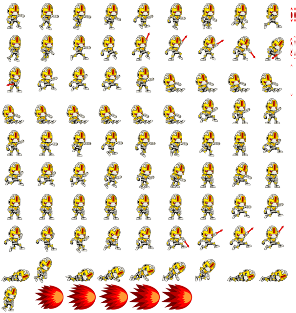
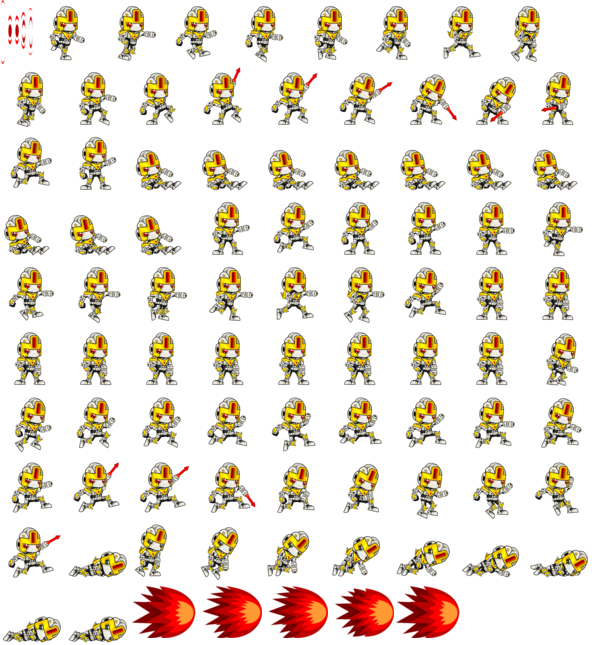
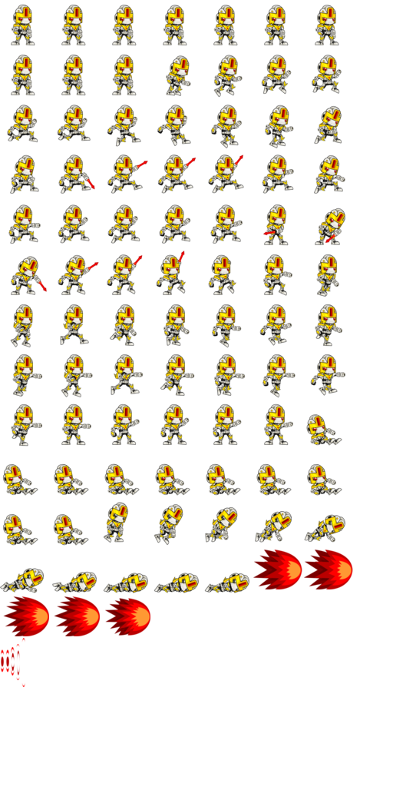
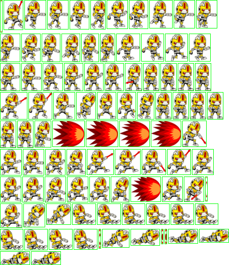
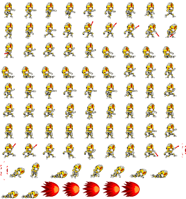
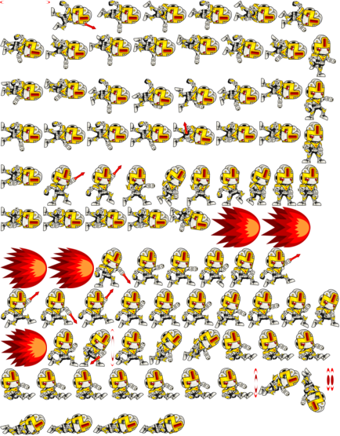

# spratlayout: layouts

`spratlayout` scans images and computes where each one goes in the atlas. It prints a [layout](layout-format.md) to stdout.

## Archive inputs

`spratlayout` accepts tar archives as input. This is useful for bundling sprite assets or working with compressed archives.

```sh
# Regular tar file
./build/spratlayout sprites.tar > layout.txt

# Compressed tar files (gzip, bzip2, xz)
./build/spratlayout sprites.tar.gz > layout.txt
./build/spratlayout sprites.tar.bz2 > layout.txt
./build/spratlayout sprites.tar.xz > layout.txt
```

The tool automatically extracts the archive to a temporary directory and processes all image files found within. Temporary directories are cleaned up automatically after processing.

## Profiles
Profiles are named rule sets that group packing options (mode, padding, scale, etc.). Instead of passing ten flags to `spratlayout`, you can define a profile in `spratprofiles.cfg` and use it with `--profile NAME`.

Profile definitions are searched in:
1. `--profiles-config PATH` (CLI override)
2. `{exe_dir}/spratprofiles.cfg` (beside the executable, portable install)
3. User config:
   - Linux: `$XDG_CONFIG_HOME/sprat/spratprofiles.cfg` (default `~/.config/sprat/`)
   - macOS: `~/Library/Application Support/sprat/spratprofiles.cfg`
   - Windows: `%APPDATA%\sprat\spratprofiles.cfg`
4. `/usr/local/share/sprat/spratprofiles.cfg` (Global)

Besides the keys matching `spratlayout`'s options (`mode`, `optimize`, `max_width`, `padding`, `rotate_direction`, ...), a profile accepts `preset=fast|quality|small|pot` (sets `mode` and `optimize` like `--preset`) and `sort=name|none|stable[:<metric>]` (like `--sort`). Command-line flags override profile values. A profile's `target_resolution=WxH|source` scales the layout only when a source resolution is known (`--source-resolution` or the profile's `source_resolution`); otherwise it is skipped.

A profile can also hold settings of the later pipeline steps, as GUIs such as [sprat-gui](https://github.com/pedroac/sprat-gui) save them: `dilate`, `gpu_compress`, `image_format`, `image_quality`, `zopfli`, `frame_lines`, `frame_line_width`, `frame_line_color`, `atlas_index` (spratpack) and `auto_animations` (spratconvert). `spratlayout` accepts and ignores them; any other unknown key is an error.

## Options
- `--mode compact|pot|fast`: Packing algorithm choice.
- `--optimize gpu|space`: Prioritize GPU-friendly dimensions or minimum area.
- `--max-width N`: Maximum atlas width.
- `--max-height N`: Maximum atlas height.
- `--no-max-width`: Disable max width limit even if profile sets one.
- `--no-max-height`: Disable max height limit even if profile sets one.
- `--padding N`: Pixels between sprites to prevent texture bleeding.
- `--extrude N`: Repeat edge pixels N times (requires padding >= extrude * 2).
- `--trim-transparent`: Remove empty borders to save space.
- `--rotate`: Allow 90-degree rotation during packing for tighter layouts.
- `--rotate-direction cw|ccw`: Direction rotated sprites are turned in the atlas (default `cw`). Use `ccw` for libGDX. Also available as profile key `rotate_direction=ccw`.
- `--multipack`: Enable multi-atlas candidate search and splitting.
- `--deduplicate none|exact|perceptual`: Detect duplicate sprites and create aliases (saves atlas space).
- `--dedup-threshold N`: Max perceptual-hash distance (0-64, default `5`) for a pair to be compared in `perceptual` mode.
- `--dedup-tolerance N`: Max per-channel pixel difference (0-255, default `8`) for `perceptual` mode to merge two sprites.
- `--incremental`: Reuse positions of unchanged sprites from the previous run, packing only new/changed ones (single atlas only; falls back to a full repack if they don't fit). `pot` atlases keep power-of-two sides; `grid` mode ignores this option. Also available as profile key `incremental=true`.
- `--sort name|none|stable[:metric]`: Order of sprites in layout (default: `none`). Images of a folder or archive are always read in natural filename order (`walk2` before `walk10`), so a folder gives the same layout on every filesystem; list files and `--stdin-list` keep their own order.
- `--scale F`: Pre-scale images (0.0 to 1.0). A trimmed sprite's packed size is chosen so that its original size scales to exactly `round(width × F)` × `round(height × F)`, so animation frames of one size keep one size at any scale.
- `--threads N`: Parallelize the packing search.
- `--debug`: Enable detailed error reporting and debug visualization.
- Directory inputs honor `.spratlayoutignore`; list files may include `exclude "path"` entries.

## Layout caching
`spratlayout` automatically caches image metadata and layouts in a private per-user directory inside the system temp directory (`$TMPDIR/sprat-<uid>` on Linux/macOS, `%TEMP%\sprat` on Windows). If your source images and options haven't changed, subsequent runs will be nearly instantaneous. Every option that affects the result is part of the cache key, so changing one always recomputes the layout. Entries older than one hour are pruned automatically, and a new `sprat-cli` version never reuses entries written by another version. On Linux/macOS the cache is skipped if that directory is not owned by you or is writable by others. Archive inputs (tar, zip, 7z, rar, or a tar on stdin) are extracted to a new temporary folder on every run, removed afterwards, and are not cached; `--debug` output is not cached either.

## Duplicate detection
Detect and alias duplicate sprites to save atlas space. `spratlayout` packs only one canonical copy per unique content and emits aliases for the rest:

- `--deduplicate exact`: content hash; only pixel-identical sprites are merged.
- `--deduplicate perceptual`: near-identical sprites are merged, such as re-exports with slight compression noise or dithering. A perceptual hash (dHash) picks candidate pairs (`--dedup-threshold N`, default `5`). The candidates are then compared pixel by pixel and merged only if every RGBA channel is within `--dedup-tolerance N` (default `8`). Pixels that are fully transparent in both sprites are ignored. Each duplicate is compared against its group's canonical sprite, so differences can't add up along a chain of similar sprites. Palette swaps and animation frames with small changes (such as a blink) stay separate.

Both modes compare the trimmed pixels, so a frame that only moves within its canvas (such as a bobbing idle frame) still counts as a duplicate. Sprites with different nine-slice insets are never merged.

```sh
# Generate layout with duplicate detection
./build/spratlayout ./frames --deduplicate exact > layout.txt
```

The layout file will contain `alias "ORIGINAL" -> "DUPLICATE"` lines for duplicates:
```
sprite "original.png" rect:0,0,32,32 trim:4,10,4,6
alias "original.png" -> "duplicate.png"
alias "original.png" -> "moved.png" trim:4,4,4,12
```

An alias whose trim offsets differ from its canonical sprite's carries its own `trim:`, so engines put it back at its original place in the canvas.

When converting to JSON/metadata, every alias becomes its own frame that points to the canonical atlas region:
```sh
./build/spratlayout ./frames --deduplicate exact | ./build/spratconvert --transform json > layout.json
```

In the built-in `json` transform, alias entries have an `alias_of` field with the canonical sprite path. Every format, such as Phaser, Godot or Unity, lists alias frames under their own names. This feature is especially useful for large asset collections with repeated sprites, reducing both atlas size and build time.

---

## Multipacking

Use `--multipack` to allow splitting across multiple atlases. With explicit max limits, splitting is constrained by those limits. With limits disabled, `--optimize` still influences whether one or more atlases are selected.

```sh
# Force small atlases to trigger multipack
./build/spratlayout ./frames --max-width 512 --max-height 512 --multipack > layout.txt
```

The layout file will contain multiple `atlas` lines. `spratpack` can then generate multiple PNG files:

```sh
# Output atlas_0.png, atlas_1.png, etc.
./build/spratpack -a atlas_%d.png < layout.txt
```

You can also extract a specific atlas index:
```sh
./build/spratpack --atlas-index 1 < layout.txt > second_atlas.png
```

Each `spratconvert` format handles several atlases the way its engine expects:

| Format | Multipack output |
|---|---|
| `json`, `raw`, `xml`, `csv`, `css`, `libgdx` | One file covering every atlas |
| `phaser-hash`, `phaser-array` | One Phaser multi-atlas JSON (`textures: [...]`), loaded with `this.load.multiatlas` |
| `godot` | One file with an `atlases` list; each frame has an `atlas` index |
| `plist`, `aseprite`, `unity.json` | One file per atlas, named after it (`atlas_0.plist`, ...); requires `--output-dir` |
| `unity.meta` | One `<atlas>.meta` per atlas PNG (`atlas_0.png.meta`, ...), each with its own GUID; requires `--output-dir` (a single atlas is also written as `<atlas>.meta` when `-a` names it) |
| `unity.anim` | Each frame references the GUID of the atlas its sprite was packed into |

```sh
./build/spratconvert --transform plist -a atlas_%d.png --output-dir ./out < layout.txt
# out/atlas_0.plist, out/atlas_1.plist, ...
```

Single-atlas layouts are unaffected.

---

## Packing examples

### Compact Mode (GPU Optimized)

Tries to keep the atlas square-ish but prioritizes width/height that fits well in GPU memory.

```sh
./build/spratlayout ./frames --mode compact --optimize gpu --padding 2 > layout.txt
./build/spratpack < layout.txt > compact_gpu_pad2.png
```


### Compact Mode (Space Optimized)

Tries to minimize total area, regardless of aspect ratio.

```sh
./build/spratlayout ./frames --mode compact --optimize space --padding 2 > layout.txt
./build/spratpack < layout.txt > compact_space.png
```


### Fast Mode

Default behavior (used by the default `fast` profile).

Uses a shelf packing algorithm. Much faster for huge datasets, but less efficient packing.

```sh
./build/spratlayout ./frames --mode fast --padding 2 > layout.txt
./build/spratpack < layout.txt > fast.png
```


### Power of Two (POT)

Forces the output atlas to be a power of two (e.g., 512x512, 1024x512), with or without padding. `--max-width`/`--max-height` then allow the largest power of two within them (a limit of 1000 allows 512), and sprites larger than that are refused with an error.

```sh
./build/spratlayout ./frames --mode pot --padding 2 > layout.txt
./build/spratpack < layout.txt > pot.png
```


### Trimming Transparency

Removes transparent pixels from sprite edges. `spratpack` can draw frame lines to visualize the trimmed bounds or apply `--extrude` to avoid sampling artifacts on edges.

```sh
./build/spratlayout ./frames --trim-transparent --padding 2 --extrude 1 > layout.txt
./build/spratpack < layout.txt > spritesheet.png
```


### Resolution Mapping

Automatically scales sprites based on a target resolution. Useful for multi-platform builds (e.g., designing for 4K, building for 1080p).

```sh
# Scale = 1920 / 3840 = 0.5
./build/spratlayout ./frames \
  --source-resolution 3840x2160 \
  --target-resolution 1920x1080 \
  --padding 2 > layout.txt
./build/spratpack < layout.txt > resolution.png
```


### Rotation

Allows 90-degree rotation of sprites to achieve even tighter packing. Sprites are turned clockwise by default, which is what TexturePacker-style formats expect (`phaser-hash`, `phaser-array`, `aseprite`, `plist`, `godot`, `unity.json`). libGDX expects counter-clockwise, so pass `--rotate-direction ccw`; the layout then carries a `rotation ccw` line that `spratpack`, `spratunpack` and `spratconvert` honor.

```sh
./build/spratlayout ./frames --rotate --trim-transparent > layout.txt
./build/spratpack < layout.txt > rotation.png

# libGDX
./build/spratlayout ./frames --rotate --rotate-direction ccw > layout.txt
./build/spratpack < layout.txt > atlas.png
./build/spratconvert --transform libgdx -a atlas.png < layout.txt > atlas.atlas
```

Formats with a fixed convention fail with an explanatory error instead of writing wrong metadata when the layout's direction doesn't match. `unity.meta` (and so the `unity` group) refuses rotated sprites in either direction. A group writes no files when any of its members fails. `json`, `raw`, `xml` and `csv` report the rotation in clockwise degrees (`90` or `270`), and `css` handles both directions.


[Back to the README](../README.md)
